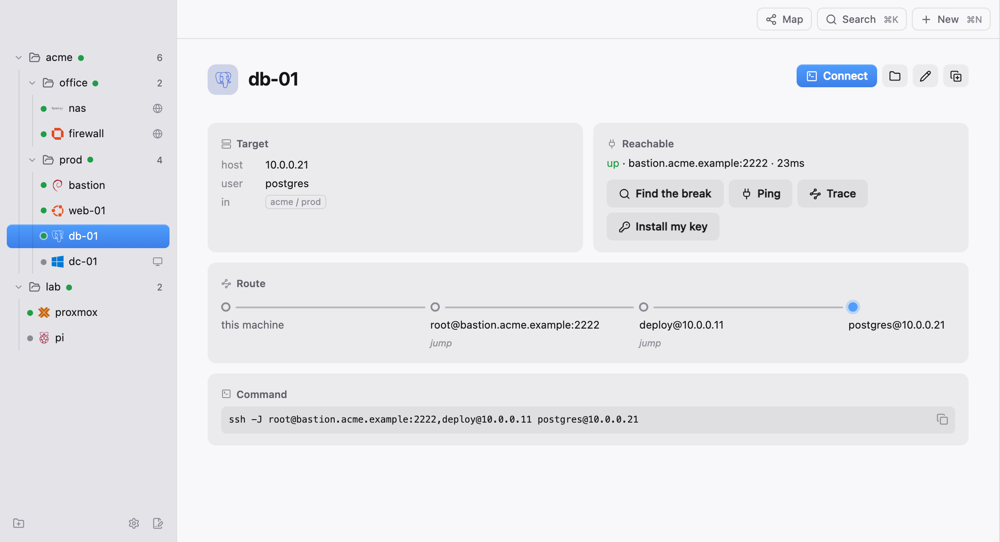

<p align="center">
  <picture>
    <source media="(prefers-color-scheme: dark)" srcset="assets/logo-dark.svg">
    
  </picture>
</p>

<p align="center"><b>Share the list, not the passwords.</b></p>

<p align="center">
  A connection manager for ssh, remote desktop, VNC, web UIs and files.<br>
  One TOML file, your own <code>ssh</code>, no Electron, no sync service, no credential store.
</p>

<p align="center">
  <a href="https://github.com/pyvnoaim/patchbay/releases/latest"></a>
  <a href="https://github.com/pyvnoaim/patchbay/actions/workflows/ci.yml"></a>
  
  <a href="LICENSE"></a>
</p>

<p align="center">
  <a href="https://github.com/pyvnoaim/patchbay/releases/latest">Download</a> ·
  <a href="#install">Install</a> ·
  <a href="#config">Config</a> ·
  <a href="#a-team">Teams</a> ·
  <a href="CHANGELOG.md">Changelog</a>
</p>

<p align="center">
  <picture>
    <source media="(prefers-color-scheme: dark)" srcset="assets/screenshot-dark.png">
    
  </picture>
</p>

---

Your machines live in one file you can read, hand-edit and keep in a repo: hostnames,
folders and jump chains, and never a credential, so the file goes on the team drive as
it is. The window opens them as tabs under a folder tree. Your `ssh` agent and
`~/.ssh/config` hold what it doesn't.

## Features

| | |
| --- | --- |
| **Sessions in tabs** | Your system `ssh` on a real pty, so the agent, `~/.ssh/config` and host-key prompts all just work. |
| **Remote desktop** | RDP decoded in-app (IronRDP, pure Rust) through RDP's graphics pipeline, H.264 on your Mac's video hardware, and a clipboard that carries files too; or handed to your own client. |
| **Web UIs and files** | A device's admin page in a tab beside its shell; browse, upload and edit files over `sftp`. |
| **Jump chains** | `db → web → bastion` resolves to one `ssh -J`, and "Find the break" says which hop stopped answering. |
| **Mine and Team** | Your own devices beside the team's shared list, on a drive you already have. No server, no account. |
| **Team host keys** | A first connect is checked against the key a colleague already trusted, and yours is offered to them. |
| **Broadcast and snippets** | Type into many shells at once; snippets fill in `{host}`, ask for a `{?}` blank, and never press Enter. |
| **Import** | Reads `~/.ssh/config` or a Royal TS `.rtsz`. Passwords never come across. |

## Install

| Platform | Download |
| --- | --- |
| macOS, Apple Silicon | [patchbay_aarch64.dmg](https://github.com/pyvnoaim/patchbay/releases/latest/download/patchbay_aarch64.dmg) |
| macOS, Intel | [patchbay_x64.dmg](https://github.com/pyvnoaim/patchbay/releases/latest/download/patchbay_x64.dmg) |
| Windows | [patchbay_x64-setup.exe](https://github.com/pyvnoaim/patchbay/releases/latest/download/patchbay_x64-setup.exe) |
| Debian / Ubuntu | [patchbay_amd64.deb](https://github.com/pyvnoaim/patchbay/releases/latest/download/patchbay_amd64.deb) |
| Linux, any | [patchbay_amd64.AppImage](https://github.com/pyvnoaim/patchbay/releases/latest/download/patchbay_amd64.AppImage) |

Every install updates itself from then on.

Or from a terminal:

```sh
# macOS, Apple Silicon
curl -fsSLo /tmp/patchbay.app.tar.gz https://github.com/pyvnoaim/patchbay/releases/latest/download/patchbay_aarch64.app.tar.gz && tar -xzf /tmp/patchbay.app.tar.gz -C /Applications && open /Applications/patchbay.app

# macOS, Intel
curl -fsSLo /tmp/patchbay.app.tar.gz https://github.com/pyvnoaim/patchbay/releases/latest/download/patchbay_x64.app.tar.gz && tar -xzf /tmp/patchbay.app.tar.gz -C /Applications && open /Applications/patchbay.app

# Linux, Debian/Ubuntu
curl -fsSLo /tmp/patchbay.deb https://github.com/pyvnoaim/patchbay/releases/latest/download/patchbay_amd64.deb && sudo apt install /tmp/patchbay.deb

# Linux, anything else
mkdir -p ~/.local/bin && curl -fsSLo ~/.local/bin/patchbay https://github.com/pyvnoaim/patchbay/releases/latest/download/patchbay_amd64.AppImage && chmod +x ~/.local/bin/patchbay && echo "installed: ~/.local/bin/patchbay"
```

<details>
<summary>First launch, requirements and platform notes</summary>

The app isn't notarized, so a `.dmg` from the browser is refused on first launch: open
it once, then System Settings → Privacy & Security → Open Anyway. The `curl` line above
skips that, because a browser marks what it downloads as quarantined and `curl` doesn't.

You need an `ssh` on your PATH. On Windows that means the OpenSSH Client, which ships
with Windows 10/11 - if it's missing, enable it under Settings → Apps → Optional
Features. Its agent is a service that is off by default, so keys with a passphrase ask
for it on every connection until you turn it on, once, in an administrator PowerShell:

```powershell
Set-Service ssh-agent -StartupType Automatic; Start-Service ssh-agent; ssh-add
```

The `.deb` wants Ubuntu 22.04 or newer, or anything else with `libwebkit2gtk-4.1`; the
AppImage carries its own. "Open in Terminal" uses `$TERMINAL` if it is set, otherwise
the first of gnome-terminal, konsole, alacritty, kitty, foot or xterm it finds.

</details>

Already have a list? Settings ▸ Import reads `~/.ssh/config` or a Royal TS `.rtsz`
document and shows what it found with tick boxes. Nothing is written until you tick.

## Config

`~/.config/patchbay/patchbay.toml`, or `%APPDATA%\patchbay\patchbay.toml` on Windows -
or wherever `$PATCHBAY_CONFIG` points. The window creates it on first run, and
Settings ▸ Config file opens it in your editor.

That one file is the whole list. Grouping is the `folders` list on each device, and a
folder can carry a note for whoever arrives at that customer next.

```toml
[defaults]                       # inherited by every jack; the jack wins
user = "root"

[jack.bastion]
host = "bastion.example"
port = 2222
folders = ["prod"]

[jack.prod-web]
host = "10.0.0.4"
user = "deploy"
key  = "~/.ssh/prod"
jump = "bastion"                 # another jack name, or a raw user@host
forward = ["8080:localhost:80", "-D 1080"]   # -L unless it says -R or -D
folders = ["prod", "web"]
desc = "main web box"

[folder.prod]
note = "change window is Tuesday 22:00; ask ops before touching bastion"
```

Jump chains resolve by walking `jump` until it runs out, so `db → web → bastion`
becomes one `ssh -J` list. Loops throw instead of hanging.

Nothing in the file is ever executed as written. The most it can produce is an `ssh`
command line, and the window shows it before it runs.

## A team

A team's list is the same file in a folder you already share. Import your Royal
document, put the file on the team drive, and point Settings ▸ Team at it; colleagues
point at the same path. Everyone sees the same devices and folder notes, and `grep`
still reads it. Nothing to install and no server in the middle, and since the file
holds no credentials, sharing it shares hostnames and nothing more.

Your own devices stay in your own file, shown beside the team's as **Mine**; moving one
across is a right-click. `[settings]` and colours stay there too. `[defaults]` goes with the list, so a
`user` or `key` there is for a *shared* account (`root@nas`, `~/.ssh/acme`; `~`
expands per machine). A personal account on a shared server goes in your
`~/.ssh/config`, which supplies what the list leaves out.

Who can edit is whoever can write the file; a read-only share is a read-only list.
Whoever can edit can also point `prod-db` at a machine they own, which is the trust a
shared Royal document extends too, minus the passwords. If someone else changed a
device between you opening it and saving, the save is refused once and the list
reloads; saving again replaces their change. A share that is away keeps the list you
were looking at and refuses to save until it is back.

A folder that syncs (OneDrive, Dropbox) works for a team that mostly reads. Two people
saving in the same minute get a conflicted copy beside the file, which the window
names and never merges; a team that edits at the same time wants a share. On Windows a
save can be refused while the sync client or someone's editor has the file open - it
goes through the next time.

## Development

```sh
npm run dev          # the app window, against dev/patchbay.toml
npm run build        # patchbay.app / .exe / .deb
npm test             # cargo test
npm run check        # formatting and lints, what CI runs
```

`npm run dev` needs Rust (`curl --proto '=https' --tlsv1.2 -sSf https://sh.rustup.rs | sh`) -
no need to restart your shell, the dev script finds `~/.cargo/bin` itself. The first
build compiles a few hundred crates and takes minutes; after that it's seconds.

Everything local runs against `dev/patchbay.toml`, a copy of the tracked sample, so you
never touch your own `~/.config` while working on it.

The app opens sessions in its own window - the system `ssh` on a real pty, with the argv
`patchbay.rs` builds, streamed to xterm.js. Your agent, `~/.ssh/config` and
host-key prompts all still work, because it *is* your ssh. "Open in Terminal" is on
the context menu when you'd rather have your own terminal.

## The rest of your machine

Settings ▸ Devices can write your devices, or the team's, to `~/.ssh/patchbay.conf` and add one `Include`
line to `~/.ssh/config`. Then `ssh web-01` works in any terminal, and so do `scp`,
`rsync`, Ansible and VS Code Remote - with the jump chains patchbay resolved, as
`ProxyJump`. Your own config is never rewritten: one line goes in at the top, a name
you already define is left to you, and turning it off takes the line and the file away.

It goes the other way too: `patchbay://web-01` in a runbook or an alert opens that
device. A link carries a device *name*, resolved against your own config - never an
address, so a link can't point you at a machine you don't have.

## Folders and web UIs

A folder with slashes (`prod/eu/web`) nests in the sidebar, and `folders` is a list,
so a device can sit in several branches at once. A device says how it is reached - `ssh`
(on by default), `rdp = <port>`, `vnc = <port>` or `url`, one of them - and that is what
Enter and a double-click open.

```toml
[jack.acme-nas]
host = "10.80.0.20"
os   = "synology"               # picks the icon, and its colour
url  = "https://10.80.0.20:5001"   # opens in a tab
folders = ["acme/prod"]

[jack.acme-dc]
host = "10.80.0.5"
rdp  = 3389                     # remote desktop, in a tab
ssh  = false
folders = ["acme/prod"]
```

A device's web UI opens in a tab, beside your terminals. Appliances are usually reached
by IP, so their certificate names something else and the page would be blank with no
explanation - patchbay says which certificate and why, and on macOS and Windows can hand
it to your system's trust store the way the browser's **Always trust** does. Linux has
no one store the webview reads, so there a device with a self-signed certificate is
one for your browser. Plain `http` works too, but only to your own network; a public
one goes to the browser.

## Files

`ssh` ships `sftp`, so patchbay uses it. Right-click a device and **Browse files**, or
the folder button in the detail pane: a tab listing the remote side, double-click to go
into a folder or to download a file, and drop files onto it to upload. Right-click a
file to rename or delete it, or **Edit here** to open it in whatever this machine opens
it with - saving puts it straight back.

Same connection as everything else - your agent, your `~/.ssh/config`, your jump chain.
Repeated listings share one ssh session, so only the first one authenticates. Windows'
ssh can't share one, so there each listing authenticates on its own, and a device that
wants a password typed can't be browsed - it needs a key or the agent.

## In the window

- **Map** draws the selected folder by the route to its devices, so a bastion and
  everything behind it sit together however they are filed. A bastion that isn't
  answering says so once.
- **Marks.** ⌘-click (Ctrl-click elsewhere) and shift-click pick out several devices; a dock appears to move,
  delete or **broadcast** to them - every ssh mark as a pane in one tab, one keystroke
  reaching all of them.
- **Find** in a session: ⌘F searches that terminal's scrollback. Every window chord is
  Ctrl+Shift off macOS, because plain Ctrl+anything belongs to the shell you are in.
- **Session logs**, off by default, append each session's output to `logs/` beside the config.
- **Updates** are checked once at launch, downloaded only when you say so, and never
  restart you: the button becomes `Restart`, a second click, because it takes your
  sessions with it.

## What it deliberately isn't

Real credentials live in your ssh agent and your existing keys - patchbay stores
none, so there's nothing here to leak or sync. There is no SSH implementation in
here and never will be: a session is `/usr/bin/ssh` on a pty, in a tab.

Remote desktop is a tab too. That one decodes RDP itself - IronRDP, pure Rust,
painted onto a canvas - so there is still no FreeRDP and no embedded graphics
toolkit, which was always the actual objection. H.264 goes to the system's own decoder
(VideoToolbox on macOS, Media Foundation on Windows), so no codec library is linked
either. "Remote desktop in system client" hands a `.rdp` file to mstsc, Windows App or
xfreerdp if you'd rather.

VNC is a handoff and only a handoff: `vnc = 5900` opens `vnc://` with whatever viewer
the machine already has - Screen Sharing on macOS, Remmina on most Linux desktops, and
on Windows whichever viewer you installed and let claim the scheme - over the same
forwarded port when the device is behind a bastion. A second protocol decoder in here
would have to earn its place, and one screen-sharing tab already exists.

Files are `sftp`, the binary, not a library. A web UI is a webview showing the device's
own page, not something we render. The pattern holds: patchbay knows where your machines
are and what to run - the running is someone else's job.

## Licence

**Free, all of it, for now** - every protocol, every tab, the shared list included, on
as many machines as you like, at a company of any size. [PolyForm
Perimeter](https://polyformproject.org/licenses/perimeter/1.0.1) is the licence: the one
thing it asks is that you don't turn it into a product that competes with this one.

Nothing is sent anywhere and there is no account: patchbay makes no outbound request
except the update check, and Bitwarden's own if you turn that on.

- **Can we change the code?** Yes, and you never have to publish what you changed.
- **Is a paid version coming?** A company licence for teams on a shared list is
  planned. One person stays free, and a team's list keeps working without one.
- **Is this open source?** The source is public and yours to read, build and fork, but it
  is not OSI open source: PolyForm asks that you don't sell a competing product built
  out of it. Using it, at work or anywhere else, is not that.
