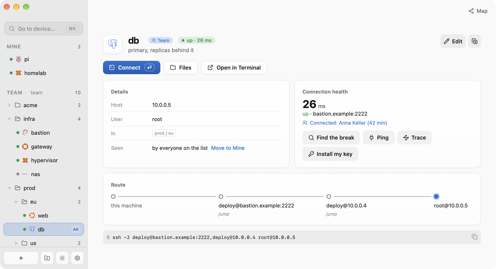

<p align="center">
  <picture>
    <source media="(prefers-color-scheme: dark)" srcset="assets/logo-dark.svg">
    
  </picture>
</p>

<p align="center"><b>Every server, one tab away.</b></p>

<p align="center">
  A connection manager for ssh, remote desktop, VNC, telnet, serial consoles, web UIs and files.<br>
  One TOML file, your own <code>ssh</code>, no Electron, no sync service, no credential store.
</p>

<p align="center">
  <a href="https://github.com/pyvnoaim/patchbay/releases/latest"></a>
  <a href="https://github.com/pyvnoaim/patchbay/actions/workflows/ci.yml"></a>
  
  <a href="LICENSE"></a>
</p>

<p align="center">
  <a href="https://github.com/pyvnoaim/patchbay/releases/latest">Download</a> ·
  <a href="#install">Install</a> ·
  <a href="#config">Config</a> ·
  <a href="#a-team">Teams</a> ·
  <a href="CHANGELOG.md">Changelog</a>
</p>

<p align="center">
  <picture>
    <source media="(prefers-color-scheme: dark)" srcset="assets/screenshot-dark.png">
    
  </picture>
</p>

---

Your machines live in one file you can read, hand-edit and keep in a repo: hostnames,
folders and jump chains, never a credential, so it goes on the team drive as it is. The
window opens them as tabs under a folder tree. Your `ssh` agent and `~/.ssh/config`
hold the rest.

## Features

| | |
| --- | --- |
| **Sessions in tabs** | Your system `ssh` on a real pty: agent, `~/.ssh/config` and host-key prompts just work. A local shell too. |
| **Remote desktop** | RDP decoded in-app (IronRDP, pure Rust) via the graphics pipeline, H.264 on the OS decoder, files on the clipboard. VNC the same way. Or hand off to your own client. |
| **Web UIs and files** | A device's admin page in a tab beside its shell. Browse, upload and edit files over `sftp`. |
| **Jump chains** | `db → web → bastion` becomes one `ssh -J`, and "Find the break" names the hop that stopped answering. |
| **Mine and Team** | Your devices beside the team's shared list, on a drive you already have. No server, no account. |
| **Team host keys** | A first connect is checked against the key a colleague already trusted. |
| **Broadcast and snippets** | Type into many shells at once. Snippets fill in `{host}`, ask for a `{?}` blank, and never press Enter. |
| **Import** | `~/.ssh/config` or a Royal TS `.rtsz`. Passwords never come across. |

## Install

| Platform | Download |
| --- | --- |
| macOS, Apple Silicon | [patchbay_aarch64.dmg](https://github.com/pyvnoaim/patchbay/releases/latest/download/patchbay_aarch64.dmg) |
| macOS, Intel | [patchbay_x64.dmg](https://github.com/pyvnoaim/patchbay/releases/latest/download/patchbay_x64.dmg) |
| Windows | [patchbay_x64-setup.exe](https://github.com/pyvnoaim/patchbay/releases/latest/download/patchbay_x64-setup.exe) |
| Debian / Ubuntu | [patchbay_amd64.deb](https://github.com/pyvnoaim/patchbay/releases/latest/download/patchbay_amd64.deb) |
| Linux, any | [patchbay_amd64.AppImage](https://github.com/pyvnoaim/patchbay/releases/latest/download/patchbay_amd64.AppImage) |

Every install updates itself from then on.

Or from a terminal:

```sh
# macOS, Apple Silicon
curl -fsSLo /tmp/patchbay.app.tar.gz https://github.com/pyvnoaim/patchbay/releases/latest/download/patchbay_aarch64.app.tar.gz && tar -xzf /tmp/patchbay.app.tar.gz -C /Applications && open /Applications/patchbay.app

# macOS, Intel
curl -fsSLo /tmp/patchbay.app.tar.gz https://github.com/pyvnoaim/patchbay/releases/latest/download/patchbay_x64.app.tar.gz && tar -xzf /tmp/patchbay.app.tar.gz -C /Applications && open /Applications/patchbay.app

# Linux, Debian/Ubuntu
curl -fsSLo /tmp/patchbay.deb https://github.com/pyvnoaim/patchbay/releases/latest/download/patchbay_amd64.deb && sudo apt install /tmp/patchbay.deb

# Linux, anything else
mkdir -p ~/.local/bin && curl -fsSLo ~/.local/bin/patchbay https://github.com/pyvnoaim/patchbay/releases/latest/download/patchbay_amd64.AppImage && chmod +x ~/.local/bin/patchbay && echo "installed: ~/.local/bin/patchbay"
```

<details>
<summary>First launch, requirements and platform notes</summary>

The app isn't notarized, so a `.dmg` from the browser is refused on first launch: open
it once, then System Settings → Privacy & Security → Open Anyway. The `curl` line above
skips that, because a browser marks what it downloads as quarantined and `curl` doesn't.

You need an `ssh` on your PATH. On Windows that means the OpenSSH Client, which ships
with Windows 10/11. If it's missing, enable it under Settings → Apps → Optional
Features. Its agent is a service that is off by default, so keys with a passphrase ask
for it on every connection until you turn it on, once, in an administrator PowerShell:

```powershell
Set-Service ssh-agent -StartupType Automatic; Start-Service ssh-agent; ssh-add
```

The `.deb` wants Ubuntu 22.04 or newer, or anything else with `libwebkit2gtk-4.1`. The
AppImage carries its own. "Open in Terminal" uses `$TERMINAL` if it is set, otherwise
the first of gnome-terminal, konsole, alacritty, kitty, foot or xterm it finds.

</details>

Already have a list? An empty window offers the hosts it finds in `~/.ssh/config`, and
Settings ▸ Import reads that or a Royal TS `.rtsz` document. Either way you see what it
found with tick boxes, and nothing is written until you tick.


## Config

`~/.config/patchbay/patchbay.toml`, `%APPDATA%\patchbay\patchbay.toml` on Windows, or
`$PATCHBAY_CONFIG`. Created on first run. Settings ▸ Config file opens it in your editor.

```toml
[defaults]                       # inherited by every jack, the jack wins
user = "root"

[jack.bastion]
host = "bastion.example"
port = 2222
folders = ["prod"]

[jack.prod-web]
host = "10.0.0.4"
user = "deploy"
key  = "~/.ssh/prod"
jump = "bastion"                 # another jack name, or a raw user@host
forward = ["8080:localhost:80", "-D 1080"]   # -L unless it says -R or -D
folders = ["prod", "web"]
desc = "main web box"

[folder.prod]
note = "change window is Tuesday 22:00, ask ops before touching bastion"
```

`jump` is walked until it runs out, so a chain becomes one `ssh -J` list. A loop is an
error, not a hang. Nothing in the file is executed as written: the most it produces is
an `ssh` command line, shown before it runs.

## Folders and web UIs

`prod/eu/web` nests in the sidebar, and `folders` is a list, so a device can sit in
several branches. A device is reached by `ssh` (on by default), `rdp = <port>`,
`vnc = <port>`, `telnet = <port>`, `serial = "/dev/…"` or `url`. That is what Enter and
a double-click open.

```toml
[jack.acme-nas]
host = "10.80.0.20"
os   = "synology"                # icon and colour
url  = "https://10.80.0.20:5001" # opens in a tab
folders = ["acme/prod"]

[jack.acme-dc]
host = "10.80.0.5"
rdp  = 3389                      # remote desktop, in a tab
ssh  = false
folders = ["acme/prod"]
```

Appliances reached by IP have certificates naming something else. patchbay says which
certificate and why, and on macOS and Windows can add it to the system trust store like
a browser's **Always trust**. Linux has no single store the webview reads, so there a
self-signed device is one for your browser. Plain `http` works on your own network only.

## A team

Put the file in a folder you already share and point Settings ▸ Team at it. Colleagues
point at the same path. Everyone sees the same devices and folder notes, with no server
in between, and since the file holds no credentials, sharing it shares hostnames only.

- **Mine stays yours.** Your own devices show beside the team's as **Mine**. **Share
  with Team** (on the page or right-click) moves one across, undoably. `[settings]` and
  colours stay in your file. `[defaults]` goes with the list, so a `user` or `key` there
  is a _shared_ account (`~` expands per machine). Personal accounts go in
  `~/.ssh/config`.
- **Who can edit** is whoever can write the file, and they can repoint `prod-db`: the
  same trust a shared Royal document extends, minus the passwords. A save over someone
  else's newer change is refused once and the list reloads. A share that is away keeps
  the list on screen and refuses saves until it's back.
- **Synced folders** (OneDrive, Dropbox) suit a team that mostly reads: two saves in the
  same minute make a conflicted copy, which the window names and never merges. On
  Windows a save can be refused while a sync client holds the file. The next one lands.

## Files

**Files** on a device's page, or right-click ▸ **Browse files**: the system `sftp` over
your agent, config and jump chain. Double-click a folder to enter it or a file to
download it, drop files to upload, right-click to rename, delete, or **Edit here** (saving
puts it straight back). Listings share one ssh session, so only the first authenticates.
Windows' ssh can't share, so there every listing authenticates and a password-only
device can't be browsed.

## The rest of your machine

- **`ssh web-01` anywhere.** Settings ▸ Devices writes your devices, or the team's, to
  `~/.ssh/patchbay.conf` with one `Include` line in `~/.ssh/config`, jump chains as
  `ProxyJump`, so `scp`, `rsync`, Ansible and VS Code Remote work too. A name you
  already define is left alone. Turning it off removes the line and the file.
- **`patchbay://web-01`** in a runbook or alert opens that device. A link carries a
  _name_ resolved against your config, never an address.
- **Open in Terminal**, on a device's page or right-click, hands the session to your own
  terminal.

## In the window

- **Map** draws a folder by route, so a bastion and everything behind it sit together.
  A bastion that is down says so once.
- **Marks**: ⌘-click (Ctrl-click elsewhere) and shift-click pick several devices to move,
  delete or **broadcast** to: every ssh mark a pane in one tab, one keystroke to all.
- **A local shell**: "local" in ⌘K opens one in a tab, ⌘D beside the session in front.
- **Background tabs** dot on new output. A drop or bell elsewhere says so, with a button
  to go there.
- **When**, on a device's page: how long your session has been open, or when you last
  opened it. On a shared list, which colleague is on and for how long.
- **Quitting** with sessions or tunnels open names each one first. Next launch offers the
  tabs back, splits and forwards included, or Settings ▸ Devices reopens them always.
- **A dropped session** keeps its scrollback under **Reconnect** and **Wait and retry**.
- **Find**: ⌘F searches a terminal's scrollback. Off macOS every window chord is
  Ctrl+Shift, because plain Ctrl belongs to the shell.
- **Session logs**, off by default, go to `logs/` beside the config.
- **Updates** are checked at launch, downloaded when you say, and installed on a second
  click of `Restart`, since it takes your sessions with it.

## What it deliberately isn't

- **A credential store.** Credentials live in your ssh agent and keys. Nothing here to
  leak or sync. A remote-desktop password you tick Remember goes to the OS keychain.
- **An ssh implementation.** A session is `/usr/bin/ssh` on a pty. Files are the `sftp`
  binary. A web UI is the device's own page in a webview.
- **FreeRDP.** RDP is IronRDP and VNC is vnc-rs, both pure Rust onto a canvas, with
  H.264 on the system decoder (VideoToolbox, Media Foundation): no graphics toolkit, no
  codec library. "Remote desktop in system client" hands a `.rdp` to mstsc, Windows App
  or xfreerdp instead. VNC signs in with a VNC password or none. A server wanting Apple's
  sign-in opens in the system's `vnc://` viewer. A VNC screen is never resized from here.

patchbay knows where your machines are and what to run. The running is someone else's
job.

## Licence

**Free for you, paid for your team.** Every protocol and tab is free for one person, at
work or anywhere, on any number of machines. A team sharing a list will need a company
licence: **€249 a year, any team size**. Until it goes on sale, free too. Terms in
[LICENSE](LICENSE).

No account, and no outbound request except the update check (and Bitwarden's own, if
you turn it on).

- **What counts as a team?** A shared list. Your own list, on all your machines, for any
  client, is one person.
- **What if we stop paying?** The shared list stops opening until you renew. Everyone's
  own devices keep working.
- **What about the copy we have now?** 0.1.58 and earlier stay under [PolyForm
  Perimeter](https://polyformproject.org/licenses/perimeter/1.0.1), free for anyone.
- **Is this open source?** The source is public to read and build, but not OSI open
  source, and a modified copy isn't yours to hand on.

## Development

`npm run dev` needs Node 22+ and Rust. It runs against `dev/patchbay.toml`, never your
own config. [CONTRIBUTING.md](CONTRIBUTING.md) has the rest.
